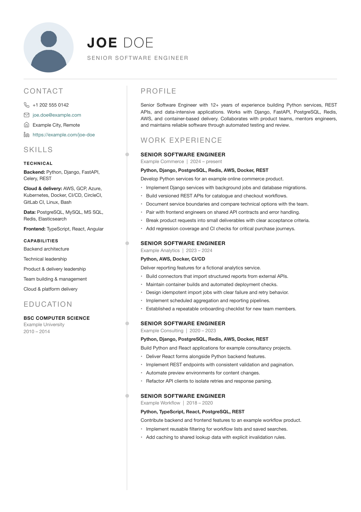
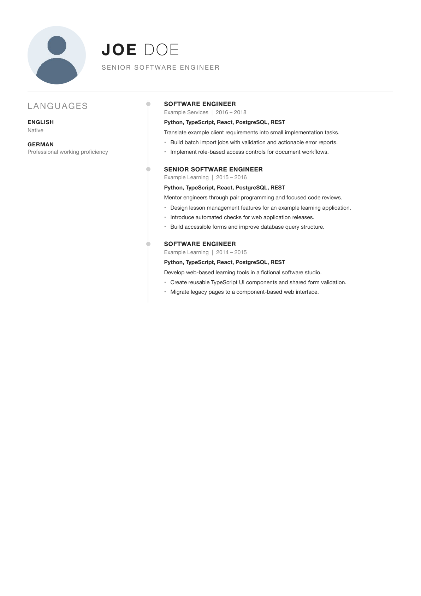

# CV Builder

An agent-friendly, data-driven CV builder with manual YAML editing, self-contained
HTML previews, A4 PDF export, and native editable Word documents. Build employment,
contracting, and freelance variants from the same content. No hosted account or
language-model API is needed to generate a CV.

The included **Joe Doe, Senior Software Engineer** profile is entirely fictional.
It demonstrates Python, Django, FastAPI, TypeScript, React, PostgreSQL, Redis,
cloud delivery, and AI-assisted engineering. Companies, dates, education,
contacts, and evidence notes are sample content. See [sample data](docs/sample-data.md).

## Sample CV preview

Rendered from the fictional Joe Doe employment sample. The generator produces a
self-contained HTML preview, an A4 PDF, and an editable Word document.



<details>
<summary>View the second page</summary>



</details>

## Quick start

Run these commands from the repository root, using Python 3.13:

```bash
python3 -m venv .venv
source .venv/bin/activate
python -m pip install -r requirements.txt
python scripts/validate.py
python scripts/build.py --format html
```

Open `output/html/employment.html` in a browser. HTML previews include their CSS
and avatar, so each preview can be opened independently.

```bash
# Editable Word documents, without Chromium
python scripts/build.py --format docx

# Install Chromium once for PDF output
python -m playwright install chromium
python scripts/build.py --format pdf

# All three formats
python scripts/build.py

# Freelance editions: concise (default) or extended
python scripts/build.py --variant freelance --edition extended

# Tailor one CV through a sparse example overlay
python scripts/build.py --application data/applications/example-agent-builder.yaml --format html

# Tests and optional local PDF diagnostics
python -m pytest
python scripts/ats_check.py
```

Output is ignored by Git. PDF and Word filenames use the candidate name from
`data/cv_data.yaml`, for example `joe_doe_employment.pdf`. Large content changes
may change page counts; review exports after editing. PDF tests skip when
Chromium cannot run. Word layout can vary by editor; inspect it in your target
Word processor before sending.

## Work with an agent

Open this repository in your coding agent and start with:

> Read AGENTS.md. Help me replace the Joe Doe sample with my CV. Ask for my
> career history, skills, education, and contact preferences. Record only facts
> I confirm, flag unsupported claims, validate the YAML, and generate an HTML
> preview before exporting PDF and Word.

For a targeted CV:

> Read AGENTS.md and tailor a contracting CV for this role using a private
> application overlay. Select only evidence that supports the role, flag gaps,
> validate the data, and build HTML for review.

The agent edits the same files as a human. There is no separate agent runtime.
See [the content guide](docs/content-guide.md) for data boundaries and workflow.

## Edit manually

1. Change name, contact, headline, profiles, education, dates, and career records
   in `data/cv_data.yaml`. Set `personal_info.photo: null` to omit the avatar.
2. Edit skills, capabilities, languages, and interests in
   `data/inventory/attributes.yaml`; select their IDs in `cv_data.yaml`.
3. Write career statements in `data/inventory/career-evidence.yaml`. Each statement
   references a career record. Select its ID in that record's `evidence_ids` or
   `summary_evidence_id`. Only `verified` statements can render.
4. Optionally add cross-career practices in
   `data/inventory/practice-evidence.yaml` and select them through an application
   overlay. A `private` disclosure prevents rendering but does not hide file contents.
5. Run `python scripts/validate.py`, rebuild HTML, and review it.

For quick one-off edits, generate DOCX and edit the document directly in Word or
LibreOffice. Those edits do not sync back to YAML; rebuilds overwrite generated files.

Audience presentation and freelance detail are controlled by `data/policies/`.
Application overlays select evidence, override a headline/profile, and adjust
presentation without duplicating the entire CV. `--edition` applies only to
`--variant freelance`. An overlay's target must match explicit CLI options.

## Keep personal copies private

This repository starts with sample data. Replacing tracked sample files with real
details makes those files personal, and committing them records those details in
Git history. Keep a separate private checkout for your real CV, or keep your real
data outside this public repository. Private overlays can live in the ignored
`data/private/` directory or at an external path:

```bash
python scripts/build.py --application /path/to/private-role.yaml --format html
```

An overlay is sparse: it does not replace all canonical identity and career data.
Git ignore rules do not remove files already tracked. Before publishing, review
staged content, assets, exported document metadata, and history. The
[privacy notes](docs/privacy.md) describe the initial extraction and audit scope.
